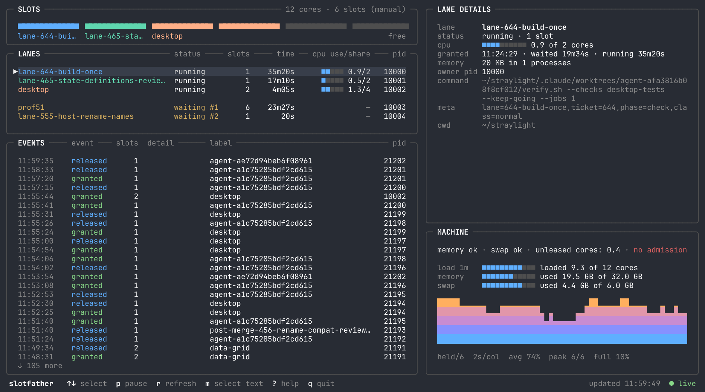

# slotfather

One queue for expensive work on a shared machine. Builds, tests and agents take
slots before they start, so separate projects share one capacity budget.



## Install

Requires Python 3.9+ on macOS or Linux. The installed commands use only the Python
standard library; Linux needs procps-compatible `ps`.

```sh
gh repo clone maxvyshniakov/slotfather
cd slotfather
python3 install.py
```

Put `~/.local/bin` on your `PATH`. Re-running the installer updates the commands
without cancelling running work. It pins them to the installer’s interpreter,
so a project’s virtual environment does not change their Python.

[Installation, migration and service accounts](docs/installation.md)

## Run work

```sh
slotfather run -n 1 --label tests -- python3 -m unittest discover
slotfather run -n 2 -- make build
slotfather run -n all -- ./benchmark.sh
```

A request waits until it can start, holds its slots while the command runs, then
returns the command’s exit status. Nested calls reuse the ancestor’s lease.
Use `--wait 60` to give up after a minute with exit code 75.

A slot is a scheduling budget, **not a CPU or memory limit**. By default, capacity
is the lower of one slot per three cores and one per 4 GiB of memory, with a
minimum of one. On Linux, a limited cgroup can determine the memory budget.

```sh
slotfather slots           # show capacity and how it was chosen
slotfather slots 6         # save a shared capacity of six, while the queue is idle
slotfather slots reset     # return to automatic sizing
```

Requests normally follow arrival order. Short work can pass a request that does
not fit, subject to the queue’s backfill rules. Low memory or swap can delay new
work; an otherwise idle machine can still start its first request.

[Capacity and configuration](docs/configuration.md) ·
[Ordering, priorities and cooperative yielding](docs/scheduling.md)

## Watch the queue

Run `slotfather` in a terminal to open the live dashboard.

| Widget | Shows |
| --- | --- |
| SLOTS | Occupied and free capacity; colours identify active tasks. |
| LANES | Active tasks, then waiting requests. Select either to see details. |
| LANE DETAILS | Command, status, resource use and the busiest processes. |
| MACHINE | Admission status, load, memory, swap and occupied-slot history. |
| EVENTS | Recent grants, releases and abandoned requests. |

Use **↑/↓** or click to select, the mouse wheel to scroll a table, **m** to
freeze updates for native text selection, **?** for help and **q** to quit.

```sh
slotfather status                  # a plain-text queue summary
slotfather status --json --pid 4242 # find a process’s lease
slotfather dashboard --once         # a dashboard snapshot for scripts
```

[Reading the dashboard](docs/dashboard.md) ·
[JSON status and metadata](docs/api.md)

## Inspect usage and leftover processes

```sh
slotfather history 20
slotfather stats --since 24h --by kind
slotfather available
slotfather advise --max 4
slotfather sweep
```

`available` reports slots a new request can get now. `advise` suggests a worker
budget from observed load; it does not reserve capacity. `sweep` is a dry run by
default. Only `sweep --live` stops eligible leftover processes.

[Statistics](docs/statistics.md) · [Sweep](docs/sweep.md) ·
[Linux and cgroups](docs/linux.md)

## Development

```sh
slotfather run -n 1 -- python3 -m unittest discover -s tests -v
```

The animation uses the real dashboard and input handling, a historical queue,
and separately recorded workload metrics. It is an illustrative demo, not a
recording of those historical processes. [Regenerate media](docs/media.md).

[Verification](docs/testing.md) · [Scheduler experiments](docs/scheduler-experiments.md)
